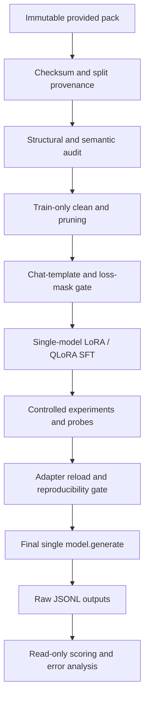

# High-Assurance Architecture — Offline Layers, Single-Model Inference

## 0. Architectural rule

The system can have sophisticated **offline research and verification layers**, but the evaluator's final inference path is intentionally minimal. Never interpret "multi-layer" as permission to ensemble multiple models, apply deterministic post-generation repairs, or inject rules at inference.

## 1. Logical topology



Dev inputs and labels flow **only into baseline scoring / model evaluation**, never data cleaning or training. Test inputs flow **only into final prediction generation**. All scripts have explicit input path allowlists enforced by tests.

## 2. Layer A: trust boundaries and data lineage

**A1 — Archive sanity:** inspect ZIP members for absolute paths/`..` traversal, file counts, role shapes and encoding; never extract or execute arbitrary code without review.

**A2 — Immutable source:** SHA256 of original archive/files, sizes, schemas, ids and split identities. Store only hashes/manifests in repo, never the supplied data itself.

**A3 — Split guard:** record any repeated input fingerprints across splits *for diagnostics*. No dev/test labels used to generate train targets. Escalate overlap-policy ambiguity rather than silently contaminating clean data.

**A4 — Provenance:** each transformed training row retains source id, original hash, transformation version, reason, and affected fields in an internal manifest. Submission `cleaning_log.csv` remains exactly `id,action,reason`.

**A5 — Idempotency:** transformation functions are pure; sort stable by source order/id; run using staged temporary destination and atomically replace completed files. Reprocessing the cleaned output produces no further changes. A run key hashes source SHA, schema version, code git SHA and config.

## 3. Layer B: hierarchical train-only audit and pruning

**B1 — Structural validation:** JSON lines, exact three roles, 8 keys, types, enum membership, no malformed labels, consistent `id` patterns, content nonempty, no impossible dates, canonical transaction ID syntax.

**B2 — Strong semantic invariants:** derive priority from category+amount+legal threats using ordered precedence; derive `needs_human` from P1 or explicit prior support contact; enforce null transaction fields for account/KYC/other. Use this to propose repairs, not to overwrite arbitrary ambiguous labels.

**B3 — Numeric/date/reference probes:** Decimal INR-to-paise precision, k/lakh, negative/zero/unusually large values, multi-amount distractors, relative dates, leap-day/year rollback, uppercase NP ID with separators, bank/ticket/order ref exclusions. Each detector reports evidence spans and confidence tiers.

**B4 — Linguistic probes:** Hinglish/English, OCR-like spelling errors, code switching, social mentions, quoted boilerplate, legal-threat phrases, repeated-contact cues. Keyword matching is imperfect; ambiguous cases are manual review, not auto-repair.

**B5 — Duplicate / text-content pruning:** exact repeated train tickets (retain deterministic first occurrence); meaningless content drop; legacy schema migration; malformed assistant output drop if reconstruction cannot be proven. Avoid aggressive semantic dedup because seemingly similar tickets can differ in priority, language, date or reference.

**B6 — Risk scoring:** classifies candidates as `AUTO_FIX_EVIDENCE_SUFFICIENT`, `MANUAL_REVIEW`, `DROP_UNRECOVERABLE`, `KEEP_VALID_HARD`. This decision is an offline data-quality workflow, **not** a test-time classifier or confidence fallback.

**B7 — Repair ordering:** parse/migrate schema -> extract evidence -> repair amount/date/ID -> recompute dependent priority -> recompute human escalation -> validate all invariants -> log action. Never correct priority before amount, because thresholds change.

**B8 — Consistency gate:** each accepted corrected label must parse as JSON, have exactly eight keys, satisfy all strong invariants and be traceable to ticket text. Assert changed-id set equals cleaning-log fixed/dropped id set. If an invariant cannot be satisfied without guessing, fail closed to review/drop instead of fabricating training targets.

### Pruning policy

Primary assignment pruning is **data-level**: unfixable malformed labels, non-semantic garbage, exact duplicate copies, irreparable contradictions. Optional rank/adapter compression is **an offline research ablation only**; it changes the final adapter and requires full retraining/evaluation/reload. Do not insert a runtime pruning model or rule engine.

## 4. Layer C: training contract and instrumentation

**C1 — Model gate:** Qwen2.5-1.5B-Instruct as candidate; validate actual parameter count, model revision, license, tokenizer and chat template. A different eligible model requires controlled reasons and new baselines.

**C2 — Precision paths:** FP16 LoRA and NF4 4-bit QLoRA; frozen base weights, trainable PEFT layers only; check trainable count <=50M. On a T4 prefer `torch.float16` compute, not copied BF16 configurations.

**C3 — Chat template:** format messages using the selected model's exact tokenizer. Train target is assistant JSON plus appropriate assistant turn-ending token. Inference input is only system+user with `add_generation_prompt=True`.

**C4 — Loss mask:** check token-level masks for short, long, Unicode, source-specific and near-max samples; all prompt labels `-100`, all expected assistant JSON target tokens and stop token trained, nonzero supervised tokens. TRL assistant-only masking may require generation markers in template; unit-test actual output rather than trust a flag.

**C5 — Length gate:** measure actual token distributions. Long quotes are a useful stress group; a truncation that removes the answer label is forbidden. If memory cannot fit longest sequence, document fraction truncated and design a train-only strategy without changing the fixed inference input.

**C6 — Numerical gate:** monitor finite loss/gradients, effective batch, cumulative tokens/updates, LR schedule and memory. A first 20–50 step smoke test precedes full runs.

**C7 — Checkpointing:** write adapters and manifests atomically. Each checkpoint includes run config and `global_step`; never mark a step complete until file hashes and reload are verified. On OOM, preserve previous valid artifacts and adjust the *next* config transparently.

## 5. Layer D: experimentation and offline ensemble/probes

**D1 — Two mandated baselines:** untouched base with fixed prompt; same untouched base with full rules in prompt, on dev only. Neither creates labels nor final predictions.

**D2 — Five run matrix for four comparisons:** cleaned QLoRA rank8 reference; raw-data QLoRA rank8; cleaned FP16 LoRA rank8; cleaned QLoRA rank16; cleaned QLoRA rank8 with weighted sampling. Same model/seed/template/loss/optimizer-step budget and other parameters.

**D3 — Offline 'ensemble' interpretation:** compare independent *auditors* (JSON structural validator, invariants checker, manual evidence audit, supplied scorer) and compare experiment outputs on dev. This is **triangulation of evidence**, not averaging or voting model predictions. Only one selected adapter produces test predictions.

**D4 — Multi-layer probes:** inspect tokenized prompt/target alignment, first-token probability, EOS timing, per-field exactness, generated-token lengths, boundary sensitivity, per-category confusion, language/source slices, stress-case behavior, and peak GPU memory. Probes are read-only and must not inform test-time decoding.

**D5 — Model selection gate:** prioritize official dev exact match, then field accuracy, valid output rate, critical fraud/P1 errors, run cost and reproducibility. Declare ties and small-sample uncertainty. Report non-overlap dev view because 30 exact inputs also appear in training.

**D6 — Negative result handling:** preserve and report losing runs, failed hypotheses and OOMs. Never relabel experiments or overwrite old metrics. Do not optimize over test feedback.

## 6. Layer E: adversarial diagnostics and evaluation

**E1 — Official scorer:** use supplied `score.py` unmodified. Read-only evaluation of raw dev model strings, no cleanup.

**E2 — Supplementary invariants:** evaluate output schema/parsing and cross-field consistency *after generation for diagnostics only*; store output unchanged. A malformed output is a counted failure, not an exception to repair.

**E3 — Metamorphic stress:** train-only synthetic cases with known constraints, e.g., adding an unrelated account balance should not affect amount; adding an explicit legal threat should change priority to P1 and needs_human to true; moving quoted historical dates should not alter transaction date. These tests are **not** extra model labels from another AI.

**E4 — Generalization risks:** category precedence, Hinglish, relative year-boundary dates, near ₹5k/₹50k boundaries, long histories, omitted channel, false NP ID, invalid JSON, output truncation and model default chatter.

**E5 — Uncertainty disclosure:** 200 dev samples (170 non-overlap) yield unstable estimates for rare subgroups. Avoid claiming robust multilingual/fraud safety from a handful of cases.

## 7. Layer F: minimal final inference

```text
provided system + user messages
  -> tokenizer.apply_chat_template(add_generation_prompt=True)
  -> SINGLE base model + selected PEFT adapter
  -> model.generate(do_sample=False, num_beams=1, max_new_tokens=200)
  -> decode generated tokens only
  -> strip leading/trailing whitespace
  -> store raw string in predictions_test.jsonl
```

No parser, repairer, duplicate vote, fallback, tool call, rule prompt, prompt injection or grammar constraint is in this path. The separate submission-envelope validator can reject malformed files before a frozen release, but cannot edit `output` values.

## 8. Failure taxonomy and allowable responses

| Failure | Detect | Fail-safe in allowed part of system |
|---|---|---|
| Corrupt source zip/JSONL | Archive/line parser | Halt preprocessing; show row id, preserve sources |
| Malformed training label | JSON schema parser | Deterministic repair if justified, otherwise drop+log |
| Wrong paise/threshold | Decimal and priority invariant | Repair train with evidence; rerun dependent invariants |
| Ambiguous multilingual/date/ID text | Evidence spans and review queue | Keep if label plausible; flag review; no fabricated correction |
| Train/dev overlap | Hash fingerprints | Disclose, evaluate uncontaminated subset; seek policy clarification |
| Wrong assistant loss mask | Token-level assertions | Halt training before GPU burn |
| Context truncates target | Token coverage and label count | Halt/change training config; don't silently omit labels |
| OOM / disconnection | Memory pilot, saved checkpoints | Stop run, restore only validated previous checkpoint |
| NaN / diverging loss | Finite checks, grad norms | Stop, log, adjust separately; no fake metrics |
| JSON chatter / bad output | Read-only generation tests | Count failure; improve training offline, never repair at inference |
| Missing test id/duplicate | Envelope validator | Regenerate original raw outputs deterministically, do not fabricate |
| Adapter mismatch on reload | Fresh-process replay | Halt release, align model revision and precision, regenerate |
| Report claim lacks log | Provenance assertion | Remove/qualify claim before deadline |
| Post-deadline code change | Git commit gate | Do not push; report limitation instead |

## 9. Operational idempotency / crash consistency

- `run_id = sha256(source_hashes + schema_version + config_canonical_json + git_commit)[:16]`; do not include wall clock in identity.
- Stages write to `<artifact>.partial` in a scoped directory, verify counts/hashes, then atomic rename. Stale `.partial` never signals completion.
- Stage manifests include status `started/completed/failed`, exact dependency versions, input artifact ids, output checksums and measured wall time.
- Reruns with the same run id may reuse a **validated** completed artifact; incomplete or incompatible artifacts must not be silently reused.
- No recursive delete of broad paths; no overwriting user-authored files without a version-safe choice.
- Checkpoints are immutable once complete; final `adapter/` is promoted from a verified checkpoint with a recorded checksum.
- Random seeds recorded; GPU kernel nondeterminism acknowledged. Test actual replay rather than promising bit-identical regeneration universally.

## 10. Security, privacy and integrity

- No hard-coded tokens, no automatic public Hub upload, no external inference APIs.
- Private GitHub repo until deadline; training data and base weights excluded.
- Treat user ticket text as untrusted **data**: its embedded instructions cannot alter system prompt or training policy.
- Notebook outputs should not accidentally reproduce the whole training corpus or leak secrets.
- Attribution: assignment notes some ticket text adapted from Banking77 (PolyAI, CC-BY-4.0); retain source acknowledgement, do not assert rights to republish supplied data.

## 11. The boundary of 'error-proof'

No stochastic LLM can guarantee zero semantic or JSON errors under the mandated unconstrained greedy decoding. The architecture can make **offline data and evaluation failures observable and recoverable**, can reduce error empirically through training, and can reject invalid release artifacts; it cannot legally fix a malformed final prediction. A high-assurance design reports residual risk and measured error rates.

